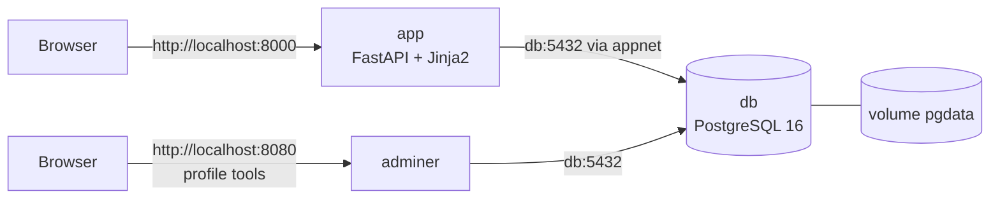

# Simulator Spiral Utang

Aplikasi web edukasi literasi keuangan: pengguna mencoba **pinjaman online
berbunga tinggi** dan **taruhan online** dengan **uang fiktif**, lalu melihat
sendiri bagaimana keduanya saling memperparah kerugian.

> **SIMULASI EDUKASI — TIDAK ADA UANG ASLI.**
> Tidak ada merek, tautan, payment gateway, atau data pribadi asli di aplikasi ini.

## Tujuan Edukasi dan Batasan

Proyek ini meniru **mekanisme** produk pinjol dan judi online, bukan daya
tariknya:

- Biaya admin dipotong **di depan**, sehingga uang yang diterima selalu lebih
  kecil daripada utang yang harus dibayar.
- Bunga harian **berbunga** (bunga yang belum dibayar ikut menghasilkan bunga).
- Taruhan punya **nilai harapan negatif**; peluang menang dan matematikanya
  ditampilkan terbuka di layar refleksi.
- Permainan slot boleh beranimasi, tetapi **tanpa suara, tanpa konfeti, tanpa
  kilau, tanpa getar, tanpa teks perayaan, dan tanpa near-miss yang direkayasa**.
- Pengguna mendapat **reality check setiap 10 putaran** (jumlah putaran, total
  taruhan, total kerugian, sisa utang).
- Layar refleksi menjelaskan bahwa mesin slot asli memakai suara dan near-miss
  untuk memperkuat dorongan bermain.

Batasan yang disengaja: tidak ada login, KYC, penagihan, notifikasi, leaderboard,
upload file, autoplay, free spin, bonus, atau "double or nothing".

## Fitur

1. Buat pemain hanya dengan nickname (tanpa password dan data pribadi).
2. Ajukan pinjaman (500 rb / 1 jt / 2 jt), cair instan, dipotong biaya admin 20%.
3. Slot 3 reel beranimasi; hasil **selalu ditentukan di server**.
4. Bayar cicilan.
5. "Maju N hari" untuk menambah bunga harian (bunga berbunga).
6. Riwayat transaksi (ledger append-only).
7. Layar refleksi: saldo, utang, total biaya admin, total bunga, total kerugian
   taruhan, jumlah pinjaman, grafik saldo vs utang, dan nilai harapan taruhan.
8. Reset simulasi (menghapus pemain beserta ledger-nya).

## Arsitektur



- Satu **user-defined network** (`appnet`) untuk semua container.
- Aplikasi menghubungi database lewat hostname service **`db`**, bukan IP atau
  localhost.
- Database **tidak** membuka port ke host.
- Data disimpan di **named volume `pgdata`**.

## Menjalankan

Prasyarat: Docker Engine / Docker Desktop dengan Compose v2.

```bash
git clone <url-repo-ini>
cd <folder-repo>
cp .env.example .env      # Windows: copy .env.example .env
docker compose up -d --build
```

Buka <http://localhost:8000>.

Hentikan: `docker compose --profile tools down` (pakai `docker compose down`
bila Adminer tidak dijalankan). Data tetap ada.
Hapus data: `docker compose down -v` (named volume ikut dihapus).

Adminer (profil `tools`):

```bash
docker compose --profile tools up -d
```

Buka <http://localhost:8080>. Server: `db`, user/password/database sesuai `.env`.

## Konfigurasi

Semua nilai dibaca dari environment variable (`.env`), file contohnya
`.env.example`. `.env` di-ignore Git dan tidak pernah di-commit.

| Parameter | Default | Env var |
|---|---|---|
| Biaya admin pinjaman | 20% dari pokok, dipotong di depan | `LOAN_ADMIN_FEE_PCT` |
| Bunga harian | 1% per hari dari utang berjalan | `DAILY_INTEREST_PCT` |
| Batas total utang | 5.000.000 | `MAX_TOTAL_DEBT` |
| Pilihan nominal pinjaman | 500000, 1000000, 2000000 | `LOAN_OPTIONS` |
| Peluang menang taruhan | 0,40 | `BET_WIN_PROB` |
| Pengali kemenangan | 2× | `BET_PAYOUT_MULT` |
| Maksimum hari "maju waktu" | 30 | `MAX_ADVANCE_DAYS` |

Dengan default tersebut, nilai harapan per taruhan = `0,40 × 2 − 1 = −0,20`:
rata-rata 20% dari taruhan hilang.

## Endpoint

| Method | Endpoint | Fungsi |
|---|---|---|
| GET | `/health` | Status aplikasi + koneksi DB (503 jika DB mati) |
| POST | `/players` | Buat pemain `{nickname}` → 201 |
| GET | `/players/{id}` | Profil + saldo + utang |
| DELETE | `/players/{id}` | Reset simulasi → 204 |
| POST | `/players/{id}/loans` | Ajukan pinjaman `{amount}` → 201 |
| POST | `/players/{id}/bets` | Taruhan `{amount}` → 201 |
| POST | `/players/{id}/repayments` | Bayar cicilan `{amount}` → 201 |
| POST | `/players/{id}/advance-days` | Maju waktu `{days}` → 201 |
| GET | `/players/{id}/ledger` | Riwayat transaksi |
| GET | `/players/{id}/summary` | Ringkasan + data grafik |

Halaman HTML: `/`, `/play/{id}`, `/play/{id}/summary`.

Contoh:

```bash
curl -X POST http://localhost:8000/players \
  -H "Content-Type: application/json" -d '{"nickname":"demo"}'

curl -X POST http://localhost:8000/players/1/loans \
  -H "Content-Type: application/json" -d '{"amount":1000000}'
```

Respons `POST /bets` memuat `won`, `reels` (tiga simbol hasil), `amount`,
`payout`, `cash`, `debt`, dan `session_bet_loss` untuk ticker.

## Model data

**`players`** — `id`, `nickname` (1–30 karakter), `created_at`.

**`ledger`** (append-only) — `id`, `player_id` (FK, `ON DELETE CASCADE`),
`type` (`LOAN` | `FEE` | `INTEREST` | `BET` | `WIN` | `REPAY`), `cash_delta`,
`debt_delta`, `note`, `created_at`.

Saldo kas dan utang **tidak** disimpan sebagai kolom: keduanya dijumlahkan dari
`cash_delta` dan `debt_delta`. Semua nominal adalah integer rupiah.

| Kejadian | Baris ledger |
|---|---|
| Pinjaman 1.000.000 | `LOAN` kas +1.000.000, utang +1.000.000; `FEE` kas −200.000 |
| Bunga | `INTEREST` utang +x (satu baris per hari) |
| Taruhan | `BET` kas −nominal; jika menang `WIN` kas +nominal×2 |
| Cicilan | `REPAY` kas −nominal, utang −nominal |

Cicilan menerima **nominal bebas** selama saldo kas cukup. Bila nominal yang
diketik melebihi sisa utang, hanya sebesar sisa utang yang dipotong dari saldo —
kelebihan tidak hangus.

Tabel dibuat saat startup dengan `Base.metadata.create_all`. Ini cukup untuk
proyek satu tabel kecil dan idempoten: saat container `app` dijalankan ulang,
tabel yang sudah ada tidak dibuat lagi, dan datanya tetap ada karena disimpan
oleh PostgreSQL di volume `pgdata` — bukan di filesystem container aplikasi.
(Pilihan lain adalah `init.sql`, tapi itu hanya berjalan sekali saat volume
masih kosong.)

## Struktur repository

```
.
├── app/
│   ├── main.py            # FastAPI: endpoint JSON + halaman HTML
│   ├── config.py          # pembacaan env var
│   ├── db.py              # engine & session SQLAlchemy
│   ├── models.py          # tabel players, ledger
│   ├── schemas.py         # validasi Pydantic
│   ├── services.py        # logika bisnis (pinjaman, taruhan, bunga, ringkasan)
│   ├── templates/         # index.html, play.html, summary.html
│   └── static/style.css
├── scripts/smoke_test.sh  # uji status code dengan curl
├── Dockerfile
├── .dockerignore
├── docker-compose.yml
├── .env.example
├── .gitignore
├── requirements.txt
└── README.md
```

## Dockerfile dan Compose

**Dockerfile** (multi-stage):

1. Stage `builder` membuat virtualenv di `/opt/venv` dan memasang dependency.
2. Stage `runtime` hanya menyalin virtualenv itu dan folder `app/`. Compiler,
   cache pip, dan file sementara tidak ikut, sehingga image akhir jauh lebih
   kecil dan permukaan serangannya lebih sempit.
3. `requirements.txt` disalin sebelum kode agar cache layer `pip install` tetap
   terpakai selama dependency tidak berubah.
4. Memakai `COPY`, bukan `ADD`: `ADD` bisa mengekstrak arsip dan mengunduh URL,
   sedangkan `COPY` hanya menyalin file.
5. Berjalan sebagai user non-root `app`.
6. `CMD` dalam exec form: `["uvicorn", "app.main:app", "--host", "0.0.0.0", "--port", "8000"]`.

Ukuran image saat diuji: **±312 MB** (`docker images`), dibandingkan base image
`python:3.12.11-slim-bookworm` ditambah dependency jika dibangun satu stage.

**docker-compose.yml**: service `app` dan `db` (serta `adminer` di profil
`tools`), network `appnet`, volume `pgdata`, healthcheck `pg_isready` pada `db`,
dan `depends_on: condition: service_healthy` pada `app`.

## Pengujian

```bash
# 1. Semua service hidup dan db healthy
docker compose ps

# 2. Ukuran image
docker images debtsim-app

# 3. Status code endpoint
./scripts/smoke_test.sh
# jika port host diganti:
BASE_URL=http://localhost:8010 ./scripts/smoke_test.sh
```

`smoke_test.sh` memeriksa 15 skenario: `/health` 200, `POST /players` 201,
`loans`/`bets`/`advance-days`/`repayments` 201, error 404, 400, dan 422, serta
`DELETE` 204.

**Uji persistensi:**

```bash
docker compose up -d
# buat pemain dan transaksi lewat browser
docker compose down
docker compose up -d
# data masih ada karena tersimpan di named volume pgdata
docker compose down -v   # ini yang menghapus volume dan seluruh data
```

## Screenshot

Simpan hasil tangkapan layar di `docs/screenshots/`:

- `docs/screenshots/01-halaman-permainan.png`
- `docs/screenshots/02-layar-refleksi.png`
- `docs/screenshots/03-docker-compose-ps.png`
- `docs/screenshots/04-docker-images.png`

## Tautan

- Artikel: _(isi oleh pemilik proyek)_
- Video YouTube: _(isi oleh pemilik proyek)_

## Atribusi

- [FastAPI](https://fastapi.tiangolo.com/) — framework web.
- [SQLAlchemy](https://www.sqlalchemy.org/) — ORM.
- [PostgreSQL](https://www.postgresql.org/) — database.
- [Chart.js](https://www.chartjs.org/) — grafik di layar refleksi (dimuat dari CDN jsDelivr).
- [Adminer](https://www.adminer.org/) — administrasi database (profil `tools`).
- Base image: `python:3.12.11-slim-bookworm`, `postgres:16-alpine`, `adminer:4.8.1`.

## Privasi dan keamanan

- Tidak ada data pribadi asli: hanya nickname dan uang fiktif.
- Tidak ada secret di repository; hanya `.env.example` dengan nilai contoh.
- `.env` di-ignore Git dan dikecualikan lewat `.dockerignore`.
- Tidak ada integrasi payment gateway, rekening, atau e-wallet.
